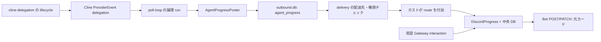

# Discord Cline エージェント進捗 UI：実装設計

確認日：2026-10-13（Asia/Tokyo）。確認基点：`c936ec24`、sun-NucBox の既存 `main` 作業ツリー。
対象は Cline provider と Discord の組み合わせ。今回の変更は未コミット。
SDK は `@cline/sdk@0.0.47`。依存追加、PR、push、Discord への試験送信は行わない。

## 1. 今回実装する UX

ユーザー要求を処理する論理 run ごとに進捗カードを1件作る。
通常時は最初の POST と、同じ message ID への PATCH だけを使う。
実行中は詳細を展開し、親の処理段階、バッチ、子タスクの状態を表示する。
成功、失敗、中断で自動的にコンパクト表示へ移行する。
完了後の「詳細を表示」「閉じる」は、元のメッセージを変更する明示的な操作。
表示状態は中央 DB に保存し、全閲覧者で共有する。クリックごとの別カードは作らない。
最終回答と中間の通常テキストは従来の別メッセージとして配送する。
確実な既存キャンセル導線に接続していないため、中止ボタンは追加しない。

折りたたみ表示にも子の一部完了、失敗、時間切れ、キャンセルの件数を残す。
親が正常終了しても子に問題があれば警告色にし、全成功に見せない。
詳細は状態と所要秒数を示し、子の返答、目的、ツール引数、ファイル名や URL は示さない。

## 2. 公式仕様の確認

参照：[Component Reference](https://docs.discord.com/developers/components/reference)、
[Using Message Components](https://docs.discord.com/developers/components/using-message-components)、
[Receiving and Responding](https://docs.discord.com/developers/interactions/receiving-and-responding)。

- Components V2 は `IS_COMPONENTS_V2 = 1 << 15 = 32768` を指定する。
- V2 では `content` / `embeds` を使わず Text Display と Container を使う。
- 一度付けた V2 フラグは解除しない。作成・編集とも同じ V2 ペイロード。
- 総コンポーネント数は最大40、`custom_id` は最大100文字。
- interaction の初回応答は3秒以内。トークンの有効期間は15分。
- 今回は初回だけ `DEFERRED_UPDATE_MESSAGE`（type 6）を返す。
  元カードの長期編集は Bot 認証による通常メッセージ API を使う。

現在の描画は Container / Text Display / Action Row / Button の最大4個。
32タスク上限でもタスクを Text Display 内にまとめるため部品数は増えない。
実行中はボタンなし、終了後は展開または折りたたみのボタン1個。
`allowed_mentions.parse = []`、`replied_user = false` で通知を抑止する。

## 3. 現行実装と変更した配線

従来は Cline の tool-started/tool-finished を文字列 `progress` に変換し、
runner の `createTurnStatusPoster()` が `kind=turn_status` を書いていた。
ホスト `deliverTurnStatus()` は `src/modules/turn-status/sticky.ts` のメモリ Map を使う。
通常 chat の配送がその参照を消し、ホスト再起動で完了カードの参照も失われる。

今回の経路：



主なファイルと責務：

| ファイル | 関数・責務 |
| --- | --- |
| `container/agent-runner/src/providers/cline-delegation.ts` | `buildClineDelegateTasksTool()` のバッチ・タスク lifecycle |
| `container/agent-runner/src/providers/cline.ts` | `onProgress` を `ProviderEvent` へ渡し event stream を起こす |
| `container/agent-runner/src/providers/types.ts` | `delegation` イベントを追加 |
| `container/agent-runner/src/poll-loop.ts` | `processQuery()` が要求・ルート・補正リトライを run に対応付ける |
| `container/agent-runner/src/agent-progress/poster.ts` | スナップショット集約、debounce、mailbox への直列書込み |
| `src/agent-progress/model.ts` | v1 wire 型、上限、許可フィールドへの再構築 |
| `container/agent-runner/src/agent-progress/model.generated.ts` | Node/Bun 独立配布用の同じ wire 契約 |
| `src/delivery.ts` | 既存の登録・配送先権限判定後、実 session/group/instance を付加 |
| `src/channels/chat-sdk-bridge.ts` | `agent_progress` の専用配送と `ncp:` interaction の早期分岐 |
| `src/channels/discord.ts` | Discord 用 transport を構築 |
| `src/agent-progress/discord.ts` | `DiscordProgress`、`progressMessage()`、永続編集・ボタン・復旧 |
| `src/agent-progress/store.ts` | async `DbDriver` を使う保存・読取り |
| `src/db/migrations/026-agent-progress-cards.ts` | 追加テーブルと索引 |

新しい進捗は sticky Map を使わない。通常 chat/chat-sdk が sticky を消しても
永続 run 参照は残る。既存の typing、firstDelivery、ambient echo の対象からも除外する。
Cline 以外、および Discord 以外の既存文字列進捗は従来経路を維持する。
mailbox の DB スキーマ、ホストとコンテナの一 writer 原則は変えない。

## 4. run とターンの対応

run ID は runner が生成する UUID v4。SDK の会話 ID やモデルの task ID は使わない。
`processQuery()` の初期入力バッチと固定した `RoutingContext` が run の単位。
`in_reply_to` は対応する受信元を示し、ホストが session / agent group /
messaging group / adapter instance / platform / thread と結び付ける。
まとめて受けた入力は同じ実行として扱い、後続の別ユーザーターンは新しい run。

途中の assistant text segment は run を終了しない。
`willRetryWrapping` / `willRetryTaskBlocks` の補正が必要なら終端化せず、
queued turn に同じ poster を保持する。別の入力が先に queued されている場合でも
補正ターンが採用された時に元の poster を取り戻す。
補正の要否を判定した後、実際に要求が終わったところで終端化する。
終了・例外・abort の後片付けでは、未終了の補正 poster も閉じる。

既存ハーネスの実行予算は引き続き SDK run/continue ごと。
UI は補正をまとめた論理 run として最大32バッチ・32タスクを保持する。
通常の子タスク実行上限は従来通り8、同時実行数3。

## 5. 子タスクのタイトルとイベント

`delegate_tasks` に objective と独立した optional `title` を追加する。
title は親が作る60文字以内の具体的な公開用タイトル：
「公式カレンダーで対象の収集日を確認」「現在の通知設定と収集日を照合」など。
省略時は「タスク N」。追加のモデル呼び出しや objective の自動要約は行わない。
親には氏名・メール件名/本文・URL・ファイルパス・認証情報・メンションや
objective/contextの転記を禁止し、操作と一般的な対象を記述させる。
実行ハーネス・投稿側・ホスト側で長さ、制御文字、メンション、URL、認証文字列などを検査し、
不適切なタイトルは切り詰めず「タスク N」に戻す。検査は網羅的な個人情報判定ではない。
title は表示だけに使い、ツール権限を付与する判断には使わない。

バッチ・タスクの内部 UUID はハーネスが生成する。
モデルの自由形式 task ID、objective、context、expectedOutput、systemPrompt、
ツール入力・結果・エラー本文は lifecycle へ入れない。

状態：

| 対象 | 状態 |
| --- | --- |
| run | running / completed / failed / cancelled / interrupted |
| バッチ・タスク | queued / running / completed / partial / failed / timed_out / cancelled |
| 親の段階 | preparing / working / delegating / synthesizing |

バッチ開始、待機登録、セマフォ取得後の子開始、子終了、バッチ終了を発行する。
子の期限切れと親 abort のキャンセルは別のタスク状態にする。
SDK の非 completed finish reason は既存仕様通り partial。
UI callback の例外は worker の成功・失敗を変更しない。
中断に応じないツールの終了待ちは既存ハーネスが保つ。

## 6. データモデルとバージョニング

wire snapshot：`version=1`, runId, revision, state, phase, batches, tasks。
ホストは UUID、数値、列挙値、件数、期間を検証し、余分なフィールドを捨てる。
非対応 version は受け付けず、既存形式を想像で解釈しない。
task title は長さ・禁止パターンの検査を通した公開用タイトルまたは連番名に再構築する。

中央 DB の `agent_progress_cards`：

- 固定対応：run_id, instance, session_id, agent_group_id, messaging_group_id,
  in_reply_to, platform_id, thread_id, channel_id, guild_id。
- Discord 対応：application_id, bot_id, message_id。
- 状態：snapshot, event_revision, revision, rendered_revision, expanded,
  delivery_state, retry_at。
- 保管：created_at, updated_at, expires_at。

`event_revision` は runner のスナップショット順序。
`revision` はボタン・復旧を含むホストの表示更新順序。
`rendered_revision` は Discord への反映済み順序。
固定対応が異なる同一 run ID は拒否する。
終端 run は後着 running snapshot で復活させない。
中央 DB トランザクション中に Discord HTTP や mailbox を待たない。
タイムスタンプはすべて JS の ISO UTC `Z` 文字列をパラメータで渡す。

## 7. 編集・競合・レート制限

同一 run は1本の Promise queue でイベント受入れ、ボタン操作、POST/PATCH を直列化する。
別 run は同じキューへ入れない。単一ホスト・単一 adapter instance の既存構成を前提にする。
ボタンは toggle ではなく明示 expand/collapse。並行クリックも処理順に適用する。
実行中更新は1.5秒でまとめ、終端は待機 debounce を置換して優先する。
保存済み未反映 revision は5秒の sweep で再評価する。
編集中に届いた終端は直列に保存・反映され、古い running 描画で上書きしない。

429 は `retry_after` を待ち、同じカードだけを再試行する。
Bot リクエストで Discord が global と示した429だけ、カード群の global 待機へ反映する。
interaction callback の429を Bot 編集 bucket に混ぜない。
通常の最終回答・質問カードはこの controller の bucket を使わない。
400/401/403/404 等の非429の4xxは lost として停止する。
PATCH のネットワーク・5xxは再試行できるが、新規カードには変えない。
削除済み・権限喪失の元メッセージを別メッセージとして自動再作成しない。

## 8. 投稿が不明になった場合

delivery_state は new → sending → sent。
POST 前に sending を保存し、応答で得た message ID と bot ID を保存する。
POST のネットワーク失敗、異常な receipt、ID 保存前のクラッシュでは uncertain に止める。
再起動時の sending も uncertain とし、無条件 POST を再実行しない。
429 は Discord が明示的に拒否した POST として new に戻せる。

これは完全な exactly once 配送の保証ではない。
「カードは届いたが ID が記録されなかった」「安全側の停止でカードが作られなかった」
という可用性の限界を残し、重複投稿を避ける。
nonce/enforce_nonce の過去数分の重複排除を、長期の exactly once 保証とは扱わない。
今回 nonce に依存する自動再投稿や不明 message の検索・採用は実装していない。
uncertain は運用上の照合が必要であり、通常回答の配送は続ける。

## 9. interaction と権限

常設 Discord Gateway の raw `INTERACTION_CREATE` が、既存の認証済み
loopback webhook を通って `handleForwardedEvent()` に届く。
`ncp:` は先に専用処理して return。未知 prefix も質問カード処理へ落とさない。
V2 の元メッセージへ legacy embeds / components の除去を送らない。
期限付き collector や interaction token の DB 保存には依存しない。

初回 type 6 は DB 検索と run キュー待ちより先に送る。HTTP timeout は1.8秒。
その後、run/message/channel/guild/application/bot/adapter instance を保存値と照合する。
登録 messaging group、継続中の wiring、detached/denied 状態、
`canAccessAgentGroup(discord:userId, groupId)` も確認する。
元メッセージをクリックできたことだけでグループ権限を与えない。
許可された閲覧者の操作は共有カードを変える。ユーザーごとの非公開展開ではない。
未知・期限切れ・不正な対応・権限不足は汎用の ephemeral 応答にまとめる。
run の存在や内部情報を個別のエラー理由で開示しない。
長期 PATCH は Bot token を使い、クリック token はその場の応答だけに使う。

## 10. 再起動・保管期限

完了カードは DB の snapshot と message ID で、新しい controller から展開できる。
詳細の保存期間は作成から7日。期限後は snapshot を消し、ボタンは利用不可と応答する。
対応の tombstone は期限後30日まで残し、その後削除する。
Discord に既に表示された一般的な進捗文面そのものは自動削除しない。

**今回の明示的な中断方針：ホスト再起動時に running カードは interrupted にして閉じる。**
古い子の queued/running 表示は cancelled にする。
生存コンテナは既存のホスト adoption に任せるが、このカードの running への再開は行わない。
そのコンテナからの通常の最終回答は従来通り配送できる。
生存コンテナと突き合わせてカードも再開する復旧方式は未実装。
安全側に中断と表示するため、実処理がその後完了してもカードは中断のままになり得る。

ホストが稼働したままコンテナが停止・消失した場合も、15秒の無更新猶予後に
中央sessionsと既存mailboxを照合する。終端progressが未配送なら通常配送を待ち、
終端が残っていない停止runはinterruptedとして閉じる。通常回答が配送待ちの間に
その後ろの終端snapshotを誤って中断扱いすることを避ける。mailboxは読み取りだけで
新しいsession storageを作らない。Discordへの編集権限を失った場合は、保存状態を
終端化できてもプラットフォームの最後の表示を更新できないという限界がある。

## 11. テストと今回の実装範囲

今回実装済み：上記の structured lifecycle、親が作る具体的な公開用 title、
turn/補正対応、outbound→host→Discord 専用配線、永続表示、権限照合、
共有展開、保管期限、unknown POST 停止、429/4xx/ネットワーク処理。

主なテスト：

- `src/agent-progress/discord.test.ts`：単一作成、V2、集約、終端、再起動、
  期限、実権限 DB、run/配送照合、共有操作、4xx、429、ネットワーク、不明 POST。
- `src/channels/chat-sdk-progress.test.ts`：常設 interaction 分岐と未知 prefix、
  V2 を質問編集へ落とさないこと、通常 chat の配送維持。
- `src/delivery.test.ts`：ホスト由来の session/group/instance/in_reply_to、
  中間 chat と同じ run の継続、firstDelivery の維持。
- `container/agent-runner/src/agent-progress/poster.test.ts`：実 mailbox と poll-loop、
  route 固定、書込み順序、補正リトライのrun維持、中間text、終端。
- `cline-delegation.test.ts`：固定 SDK の子イベント、title、timeout/cancel、
  並列・MCP hooks・認証の既存回帰。
- migration portability、ホスト・runner 全体の回帰とそれぞれの型チェック。

今回の検証はモック Discord HTTP と隔離された実 DB/SDK が中心。
本物の Discord への試験投稿・ボタンクリックは行っていない。
実 Discord の V2 受理、実ネットワーク下での3秒以内応答、見た目は未確認。
特別な複数ホスト間ロック、未知 POST の自動採用、running カードの adoption、
中止ボタン、詳細ログや機微情報の表示は未実装。

## 12. 導入・検証・ロールバック

対象は現在の main ディレクトリ。既存未コミット変更を保持し、今回 commit/push はしない。
導入前に SQLite の backup API で中央 DB の整合したバックアップを保存する。
`pnpm run build` でホストを更新し、停止状態で `pnpm run migrate` を実行する。
ローカルコミットで起動マーカーが古い場合は、
`docs/upgrade-recovery.md` の local-customization 手順に従い、ビルド・テスト・必要な
migration 完了後に `pnpm exec tsx scripts/upgrade-state.ts set` で正式に記録する。
この install の systemd サービスを再起動し、プロセスだけでなく CLI の応答も確認する。
026 migration は追加テーブルのみ。既存 agent/session データは変更しない。
runner は `/app/src` の read-only bind mount を使う。
依存ロック・Dockerfile に変更がないため、一致する既存イメージを使用できる。
古い実行中コンテナはモジュールをキャッシュしている場合がある。
新しい進捗は、新しいソースで起動したコンテナから有効になる。

```sh
pnpm run typecheck
pnpm exec tsc -p container/agent-runner/tsconfig.json --noEmit
pnpm test
(cd container/agent-runner && bun test --isolate)
# リポジトリルートで wire の一致も確認する
cmp src/agent-progress/model.ts container/agent-runner/src/agent-progress/model.generated.ts
```

起動後は service active、026 migration、Discord adapter/approval/CLI の起動、
追加エラーの有無を確認する。隔離コンテナで SDK/runner のテストも行う。
Discord での目視は、ユーザーが通常どおりエージェントに依頼した際に確認する。
確認のためだけにこちらから Discord へ送信しない。

ロールバックはサービスを停止し、今回変更したファイルだけを導入前の保存状態へ戻す。
既存の poll-loop のローカル修正や他の未コミット変更を巻き戻さない。
ホストを再ビルドし、通常のサービス手順で起動する。
追加テーブルと migration 記録は残しても旧コードの既存テーブル処理を妨げない。
中央 DB 全体のバックアップ復元は後発データを失うため、単なるUI取消しには使わない。
旧カードが残る間は `ncp:` と未知 prefix を質問経路へ落とさないガードを保持する。
V2 メッセージは legacy embeds へ戻せないため、旧ボタンを使用不可にする際も
旧質問ハンドラへ無条件に戻すロールバックは行わない。

## 13. 今回の確認記録

2026-10-14追記：子の上限到達時に親判断で1回継続できる
`resume_delegated_task` と、親の空回答を1回だけツール禁止で回復する処理を追加。
詳細は `docs/cline-delegation.md` の recovery 節を参照。
継続は同じrun/taskの表示を更新し、空回答の補正中はカードを終端化しない。
補正にも失敗した場合は失敗通知を配送し、カードもfailedとして閉じる。
以下は10/13のUI導入時の検証記録で、10/14の回復処理の検証とは区別する。

2026-10-13 の確認結果：

| 検証 | 結果 |
| --- | --- |
| ホスト全体 `pnpm test` | 3,687成功・1 skip・失敗0（302成功ファイル） |
| runner 全体 `bun test --isolate` | 665成功・3 skip・失敗0 |
| 最終ホスト関連6ファイル | 95成功・失敗0 |
| 最終poster/poll-loop | 4成功・失敗0 |
| 使用中イメージの隔離検証 | 17成功・失敗0。外部ネットワークなし |
| ホスト・runner 型チェック | 両方成功 |
| 新規ホスト実装のlint | error 0、UIの失敗分離・入力検証を行うcatchについてwarning 4 |
| wire契約の一致 / diff空白チェック | 成功 |
| ホストbuild | 成功 |
| service / CLI / Discord Gateway | 起動・応答・接続を確認 |
| 026 migration | `agent-progress-cards` 適用済み |
| 本物のDiscordへの試験投稿 | 未実施。確認時のカード保存件数0 |

ローカルコミット後の起動マーカーが以前のリビジョンのままだったため、最初の再起動は
upgrade tripwire に停止された。DB変更前の停止を確認し、`docs/upgrade-recovery.md`
の local-customization 手順で migration と正式stampを完了して復旧した。
以降は `bin/ncl groups list --json` の正常応答を含めてヘルスを確認した。
生存していた2セッションは既存のadoption処理で復旧した。

導入前中央DBの整合したバックアップは
`data/backups/discord-progress/2026-10-13-v2-before-progress.sqlite` に保管する。
ファイルは0600、保管ディレクトリは0700。通常のUIロールバックでは復元しない。
main の HEAD は確認基点 `c936ec24` のままで、新規commit/pushは行っていない。
